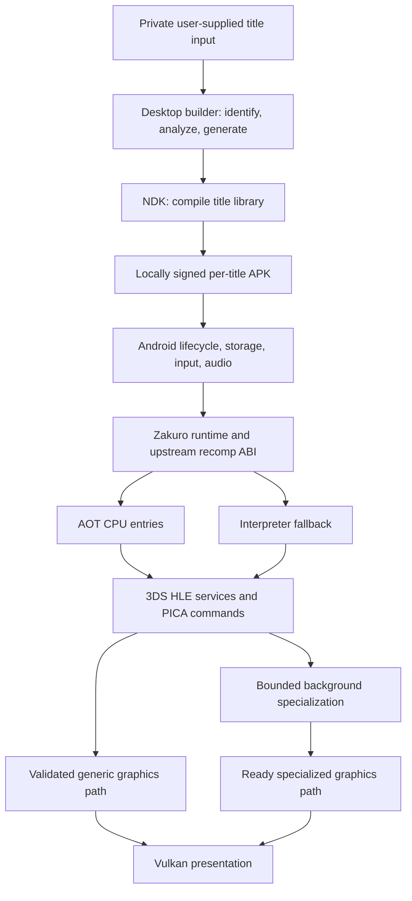

# DroidDS architecture proposal

<!-- CodexAstraUlt: Convert the supplied research into a conditional integration design; retain evidence gates where upstream behavior does not yet meet the desired product. -->

Status: proposed implementation direction, 2026-10-17. See the
[source audit](RESEARCH_REVIEW.md) for what was actually inspected.
The first implemented subset is documented in [build evidence](builds/0.0.1-foundation.md).
The owner's additional reuse candidates are evaluated in
[the AnyPS5/Azahar/MMJ/Uberhar review](REUSE_CANDIDATES.md).

## Product and component boundaries

DroidDS should be a reusable native Android runtime with locally generated
per-title CPU code. Start from pinned 3dsrecomp and Zakuro; preserve their ABI,
interpreter, services and PICA paths. Avoid building another CPU, HLE kernel or
renderer before proving the existing foundation. AOT converts guest instructions;
it is not recovery of original game source or a native remake of game rendering.

The diagram is the intended design. It does not mean every generic pipeline is
already ready, every queue bounded, or Android supported by the inspected source.

| Boundary | Initial choice | Proof needed |
| --- | --- | --- |
| CPU producer | 3dsrecomp emits C, compiled with strict floating-point flags | ARM/Thumb/VFP semantics, ABI layouts and controlled fallback |
| Runtime | Zakuro core, CPU, filesystem and GPU crates | Resolved dependency graph; services and module lifecycle |
| Desktop tools | Rust CLI around existing compiler interface | Explicit cross-toolchain, paths with spaces, cancellation, repeatability |
| Android host | Small Kotlin lifecycle/storage/input shell; narrow JNI/C interface to Rust | Bionic linkage, surface ownership, audio routing, process death |
| GPU | Existing software/reference and Vulkan paths | Independent correctness, cold fallback availability, bounded work |
| Distribution | Generic tools publicly; private per-title APK built locally | Packaged library identity, stable local signing, upgrades retain saves |

## Initial decisions and alternatives

| Decision | Recommendation and rationale | Revisit when |
| --- | --- | --- |
| D01: base | Separate Zakuro-first integration; its runtime already consumes recomp-abi | Desktop evidence reveals an unaffordable compatibility gap |
| D02: upstream management | Pin full commits and resolved Cargo graphs; keep local patches identifiable | First build audit chooses submodules versus source imports |
| D03: CPU contract | Adapt the real ABI; do not implement the pack's conceptual trait as a replacement | Upstream ABI evolves through an explicitly reviewed update |
| D04: package | Private per-title sideloaded APK, runtime + generated library in standard native-library locations | Proven v1 and a justified plugin distribution design |
| D05: Android floor | API 29 is a candidate OS floor, ARM64 only initially; verify dependencies before fixing it | Android fixture and minimum-device capability audit |
| D06: Vulkan floor | Current upstream requires Vulkan 1.3 and additional features; reject unsupported devices clearly | A tested lower-feature backend is deliberately implemented |
| D07: evidence | Synthetic Linux baseline first; early Android ABI/loader probe in parallel | Core fixture is reproducible, then full Android integration |
| D08: licensing | Inventory exact source and dependencies before distribution; no automatic Uberhar code import | Any new source reuse or binary dependency |

Proposed ownership: Android owns Activity and surface events; one runtime owner
serializes guest execution and state transitions. Audio callbacks consume bounded
buffers. GPU workers receive immutable job inputs, retain valid object lifetimes
and publish completed results. Do not introduce a new render thread solely because
the research diagram contains one; first map upstream ownership and lock order.

## CPU correctness contract

- Pin producer, ABI and runtime together. The verifier's current lockfile resolves
  an older Zakuro revision than the proposed runtime; record and resolve that gap.
- Test exact C/Rust layouts, exported symbols, Android dynamic dependencies and
  ABI mismatch rejection. Guest 4 KiB pages must not imply 4 KiB host pages;
  validate native ELF/APK alignment for 16 KiB Android hosts.
- Preserve unknown-entry, unsupported-instruction, missing-library and stale-code
  fallback. Package hashes and native-origin checks serve different purposes.
- Establish executable-write invalidation or an explicit supported-code policy.
  Initial module checks alone do not prove safety after guest code modification.
  Unsupported mutations must force interpreter fallback or a controlled stop
  before affected native code reexecutes; a documentation warning is insufficient.
- Test CRO relocation, unload/reload, ARM/Thumb interworking, exceptions, exclusive
  accesses and scheduling across native/interpreter transitions. Block budgets
  are not cycle counts; comparison boundaries must respect documented live state.
- Correct the verification methodology before trusting zero mismatches: report
  timeouts/inconclusive cases and compare integer/memory bits strictly. A limited
  VFP NaN policy must not hide unrelated integer or memory differences.

## Graphics continuity and memory contract

Treat three costs separately: recompiled game CPU execution, PICA vertex/geometry
processing, and raster/fragment pipeline work. Zakuro's default PICA CPU shader JIT
is separate from the game AOT compiler; both its jobs and Vulkan jobs need limits.

The desired miss path uses an already available accurate fallback, returns
promptly and optionally admits specialization. First enumerate mandatory pipeline
families, formats and fixed-function states. Measure startup preparation cost and
coverage. Finite precreation, validated dynamic state or another accurate existing
path may cover a family; choose by evidence. If no ready path exists, the no-wait
gate fails. Do not claim a complete solution by warming one recorded scene.

Queue admission must never block the guest thread because optional work is full.
Deduplicate work, cap pending/running/completed jobs, apply generation IDs on title
switch, and stop repeated failure retries. Cap pipeline and shader-JIT populations
before optimization. When a budget is reached, retain correct fallback and defer
optional work. In-flight GPU objects and live native code cannot be freed early.
If later eviction is needed, use fence/lifetime-aware retirement with tests.

Account separately for guest RAM, title mappings, surfaces/textures, pipelines,
shader JIT code, compile jobs, audio and diagnostics. Driver allocation size may be
opaque: report measured process/GPU memory alongside counts and known byte totals;
do not claim a hard byte ceiling from object counts alone. Detect both continued
in-game growth and failure to recover across repeated normal exits.

Keep runtime pipeline maps, portable recipes, translated shaders and opaque
driver caches distinct. Fingerprint opaque cache validity, enforce read and write
limits, and save atomically. A portable journal/prewarm is later work; it cannot
prove complete unseen-state coverage or replace a working cold fallback.

## Android and data ownership

The Android app must run directly on Bionic with normal Vulkan/audio/input APIs.
No PRoot, X11, vendor gaming service or Google service is required. Separate
desktop UI dependencies instead of porting the whole desktop frontend.

Use SAF for selection and persist permission where available. Benchmark random
access; use a cancellable, space-checked app-private import when the provider
cannot support the required access. Bind executable, update and CRO identities to
the private manifest. Mismatch disables unsafe native execution with an actionable
message; never silently treat another revision as compatible.

Package identity and signing keys must persist across local upgrades. Saves live
outside disposable build/cache directories; use atomic replacement and recovery
tests. Do not reuse Uberhar's keystore. Optional crash evidence is bounded,
file-based and available through explicit export, with no recurring crash browser
or per-launch bundle. Normal logs use one bounded writer, rotated retention and
aggregate counters; verbose per-call or per-draw tracing is opt-in and capped.

Support a stacked two-screen viewport and correct lower-screen touch mapping
first. Design surface ownership to permit Thor's second physical display, then
qualify dual-display behavior before claiming Thor handheld readiness. Additional
layouts, texture packs and enhancements follow correctness and memory gates.

## Principal risks and decisions to make

| Risk | First experiment | Response if it fails |
| --- | --- | --- |
| Verification hides defects | Known-bad synthetic native results and timeout cases | Repair oracle before claiming parity |
| Android toolchain/ABI mismatch | Small NDK-built fixture loaded on Thor | Isolate compiler/loader changes before frontend investment |
| Cold generic creation stalls | Instrument actual Vulkan calls and force family misses | Restrict claim; implement ready fallback for missing families |
| Compile/JIT/pipeline growth | Unique-state flood, failure injection, repeated shutdown | Bound admission and ownership before private long runs |
| Dark Moon needs unsupported services or GPU behavior | Early upstream-only private compatibility baseline | Identify missing subsystem; keep simple control title |
| Generic rendering too expensive | Matched path and resolution profiles on Thor | Optimize measured stage; retain correctness and fallback |
| Licensing/provenance incomplete | Exact dependency and notice inventory | Hold affected distribution until provenance is resolved |
| Goals exceed sustainable hardware capacity | Repeated normal-speed thermal runs | Report title/device limit honestly; no draw skipping |

No replacement of Uberhar is planned. An Azahar AOT backend remains a separate
possible study if the selected foundation fails its gates; it is not an automatic
fallback that silently expands this project.
