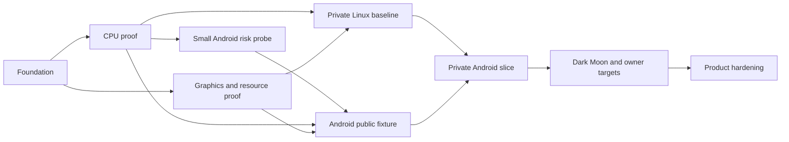

# DroidDS delivery roadmap

<!-- CodexAstraUlt: Replace the research pack's broad serial implementation sequence with evidence-gated work and early Android, memory and correctness risk checks. -->

<!-- CodexAstraUlt: Record the first CPU implementation without promoting full
milestones whose instruction/lifecycle/device gates have not been exercised. -->
Date: 2026-10-17. **The first CPU foundation build 0.0.1 passes locally.**
Exact dependencies, an original test host, strict comparisons and four synthetic
native/fallback cases are implemented. See [build evidence](builds/0.0.1-foundation.md).
M0/M1 are partially demonstrated; full runtime builds, broader CPU/module tests,
graphics and game-performance gates below remain open.
<!-- CodexAstraUlt: Replace the pending CPU device status with the owner's
validated report; keep the reported fixture pass distinct from full A0 and GPU
qualification or an independently hash-bound ADB run. -->
The owner-supplied 0.0.2 [Thor CPU report](device-tests/0.0.2-thor-cpu.md) passes
all four fixture cases and both corruption controls on reported Android ARM64
with 4 KiB host pages. The subsequent
[0.0.3 Thor report](device-tests/0.0.3-thor-cpu-vulkan.md) also passes all CPU and
offscreen Vulkan checks on Adreno 740/Android 13. Its Vulkan 1.3.128 advertisement
and simple output checks do not qualify all full-renderer features or PICA paths.
Broader Android qualification, picker lifecycle and 16 KiB-page execution remain
open. The upload does not establish its export method. See
[the separate build evidence](builds/0.0.3-android-vulkan.md) for host/packaging checks.

<!-- CodexAstraUlt: Record implemented 0.0.4 scope while retaining the pending
Thor gate and distinguishing a backend fixture from the real PICA renderer. -->
Version **0.0.4 is implemented and awaits Thor qualification**: eight bounded
CPU fixtures, source-origin/changed-code/write-protection controls, and a Vulkan
capability query plus representative backend pipeline fixture. This does not
complete broad CPU, scheduler, module-lifecycle or PICA qualification. The
[New 3DS audit](NEW3DS_AUDIT.md) executed the pinned parser/allocator and reproduced
header-decoding and application-memory gaps; their actual runtime corrections
are required during 0.0.5 integration.

## Versioned path to 0.1.0

<!-- CodexAstraUlt: Add the owner's requested version-by-version alpha plan.
Separate platform probes, real 3DS homebrew, owned-game boot and playable release
gates; version targets are plans, not measured compatibility or delivery dates. -->

This is the intended release sequence as of **2026-10-19**. Versions 0.0.1–0.0.4
are implemented; 0.0.4 device qualification remains pending. Later versions below
are milestone targets, not promised dates
or a fixed number of APK installations. A stage can need several prereleases;
failed acceptance checks hold promotion, and any revised scope must be recorded.
We can bring a game up earlier when its prerequisites pass rather than waiting
for an arbitrary version number.

**First visible 3DS homebrew on Android: target 0.0.6. First owned retail-game
boot on Android: target 0.0.7. First repeatable playable game segment: target
0.0.8. Version 0.1.0 is the first qualified, limited early alpha.**

### What the existing builds do

- **0.0.1:** original small ARM/Thumb programs run as recompiled native code on
  Linux and are checked against an interpreter and known correct outputs.
- **0.0.2:** the CPU checks run inside an ARM64 Android APK. The owner's Thor
  report passes all four fixtures and both intentional error checks.
- **0.0.3:** retains the CPU checks and asks Vulkan to draw red, green and split
  red/green 16×16 images into an offscreen image. It reads every pixel back,
  repeats across three fresh device/resource sets, and checks that deliberately
  changed pixels are rejected. It also records device/driver context and adds
  **Save report**. Host execution, APK publication and the owner's Thor CPU/GPU
  report pass. Picker/lifecycle behavior and full renderer compatibility remain
  separate checks.
- **0.0.4:** expands to eight CPU fixtures with reverse ARM/Thumb interworking,
  flags/shifts, a narrow finite-VFP case and tiny-budget progress. Adds bounded
  stale-origin, changed-code and executable-memory write controls. Queries the
  selected runtime's Vulkan requirements and exercises a representative backend
  pipeline against exact expected output. Thor qualification is pending. The
  accompanying [New 3DS audit](NEW3DS_AUDIT.md) identifies concrete parser/memory
  corrections for runtime integration.

The offscreen images are test inputs, not 3DS frames. Versions 0.0.3–0.0.4 do not load
a game, translate PICA graphics, present game screens, implement game controls
or measure game speed. These small tests isolate Android loader/ABI and basic GPU
failures before the larger runtime is integrated. They do not establish that the
entire project is close to complete or that its performance target is achieved.

### Planned builds

<!-- CodexAstraUlt: Put concrete user-visible outcomes next to acceptance gates;
start ownership, memory bounds and mobile compatibility before game workloads. -->

| Target | Work and deliverable | What must be demonstrated before promotion |
| --- | --- | --- |
| **0.0.4 — qualify the runtime foundation** | Implemented: eight CPU fixtures, bounded code-safety controls, Vulkan capability/representative backend fixture and the New 3DS audit. Thor report pending. | Native/interpreter outputs and safety controls pass on the Thor; Vulkan 1.3 requirements and representative pipeline output pass, or missing capabilities become explicit integration decisions. This fixture does not execute PICA translation, full scheduler/CRO behavior or a game. |
| **0.0.5 — integrate the full runtime** | Bring in the existing Zakuro services, loader and PICA paths around the recompiled CPU contract. Fix the audited New 3DS parser, resolved memory layout and configuration reporting, with actual loader/kernel regressions. Execute real renderer tests and establish an exact-revision private control-game baseline on Linux. Attempt Dark Moon's opening early when private inputs are available. Audit and cross-link the full Android dependency graph in parallel. | Public 3DS fixtures execute through CPU, services and PICA; GPU tests actually run. New/Old model memory and reporting regressions pass; Xenoblade requires its own private baseline. Shader jobs/results/retained objects have admission limits and safe retirement before private runs. Record control-title boot/checkpoint evidence, native/fallback routes and Dark Moon blockers. Android/Bionic/PICA-JIT problems are exposed here, before a full frontend depends on them. |
| **0.0.6 — visible Android 3DS application** | Connect the real runtime to Android display surfaces, a stacked two-screen layout, controller/touch input and audio. Run an original 3DS homebrew program with observable interactions. | Guest-generated screens are displayed on the Thor; controls/touch change guest state and guest audio is heard. Pause/resume, surface replacement and normal exit work. A native Android animation or direct Vulkan demo alone cannot pass this stage. This is the first visible 3DS-program target. |
| **0.0.7 — first owned-game boot on Android** | Finish the local per-title build/package path, exact game/update/module identity checks and private data import. Establish persistent signing/package identity and durable save locations. Package the private control title that passed the host baseline. | A reproducible private APK launches the matching owned title into an interactive menu or identified opening scene on the Thor. Native execution and interpreter fallback are measured. Wrong revisions are rejected safely; replacement builds preserve identity and app data. This is a boot milestone, not sustained playability. Attempt the equivalent Dark Moon checkpoint and record any blockers. |
| **0.0.8 — first playable game segment** | Make one defined control-title route repeatably playable with controls, touch, audio, saving/loading and lifecycle recovery. Fix reproducible CPU/service/PICA problems. Continue Dark Moon moon/ghost/opening diagnosis and targeted corrections. | The same gameplay route can be played, saved, exited normally and resumed on the Thor at 1× with correct output. Compare native/interpreter and graphics paths where relevant. A title screen or a single cutscene is insufficient. Report Dark Moon's visual, speed and crash status separately. |
| **0.0.9 — sustained and cold-run qualification** | Stress the existing resource limits, cold generic-rendering coverage, cache handling, logging cost and repeated teardown. Optimize measured bottlenecks. Measure 1× first, then 2×/4×; qualify Thor display options separately. | Required draws survive delayed/failed/full shader workers. Memory settles during the chosen workload and recovers over normal exits. Collect repeated frame-time/speed/audio/thermal evidence and a 30-minute route. Record which resolutions meet the playability target and which remain limited. Limits and safe cleanup are strengthened here, not introduced for the first time. |
| **0.1.0 — limited early alpha** | Deliver the usable Android runtime plus repeatable local title-building instructions, stable updates/saves and a measured compatibility list. | At least one explicitly named owned title/revision has repeatable playable gameplay on the tested Thor configuration, including the sustained route and save/restart tests below. Publish exact supported scope, known failures, resolution results and Dark Moon status. Full-library compatibility is not implied. |

### What 0.1.0 means

<!-- CodexAstraUlt: Define an assessable first-alpha contract without promising
perfect Dark Moon, universal performance, or retail-derived public artifacts. -->

For a title to be listed as playable in 0.1.0, record its exact revision, driver,
settings and route. Require correct output over the qualified route, working
input/audio/save/load, at least three matched runs and a 30-minute sustained
sample. Apply the [playability protocol](TEST_STRATEGY.md): the current target is
at least 99% of measured gameplay at 95% emulation speed or better, without
recurring stalls or known serious audio/visual faults. Verify three normal
launch/exit cycles, bounded workload memory and an update that preserves saves.
Initial acceptance may be at 1×; every claimed 2× or 4× result needs separate
measurement. One tested route is not a claim of a complete playable game.

Dark Moon remains a priority throughout the private-game stages, starting with
early host reconnaissance rather than waiting until 0.0.9. Its target remains
correct moon/ghost rendering and fully playable speed, with the broader 2×/4×
headroom goals. We cannot promise those outcomes by 0.1.0 before the selected
runtime can execute and profile that title. If it remains blocked, the alpha
must say exactly where and why; another title's pass cannot clear Dark Moon.

HD texture packs, broad library compatibility, Retroid-specific qualification,
and universally smooth cold 4× gameplay are later qualification work. They are
not required to show the first game running, nor assumed solved by native CPU
recompilation. Thor dual-display support must be explicitly tested before it is
listed as supported; a working stacked layout can qualify the initial alpha.

### Reuse, dependencies and parallel work

<!-- CodexAstraUlt: Explain the actual integration effort and the private local
builder boundary so the release sequence is not mistaken for a universal ROM APK. -->

We will continue reusing 3dsrecomp's compiler/ABI and Zakuro's CPU interpreter,
services and graphics components. The main work is integration, correctness,
Android adaptation and resource/performance fixes. We are not planning to write
an entire emulator from scratch. Specific AnyPS5/Azahar/MMJ/Uberhar components
remain candidates after their actual fit and license requirements are reviewed.

The initial architecture creates **private per-title APKs on the Linux laptop**:
the builder converts the matching game's CPU code and packages it with the
runtime, then imports the required private game data. Public GitHub releases
contain generic tools/runtime and original or suitably licensed homebrew only.
This roadmap does not imply a universal APK that immediately launches any ROM.
Selecting and testing an exact owned title is a real dependency for the private
baseline and Android game stages; no game upload is needed to continue public
fixture work. Private game inputs and derived artifacts stay in the local test
environment.

CPU safety, host GPU integration and the local packaging tools can advance in
parallel. The 0.0.3 basic Thor probe has passed; 0.0.4 now addresses the broader
CPU, full-renderer capability and New 3DS audit gates. One
local device coordinator serializes Thor tests, and actual hardware results are
required before Android promotion. Use automated host/CI checks for routine
iterations and device builds for meaningful new checkpoints. We do not need the
owner to manually test every code change or wait for a perfect frontend before
attempting a game boot.

The version targets map to the engineering milestones below: 0.0.4 develops
M1/A0, 0.0.5 develops M2/M3, 0.0.6 develops M4, 0.0.7–0.0.8 develop M5, and
0.0.9–0.1.0 qualify a bounded subset of M6/M7. A published version does not
automatically close all requirements of the corresponding engineering milestone.

## Engineering milestones

| Milestone | Deliverable | Exit evidence | Dependencies |
| --- | --- | --- | --- |
| M0: reproducible foundation | Exact source/dependency/toolchain pins, provenance inventory, Linux build entry point, public fixture scaffolding | Fresh checkout builds required tools with locked dependencies; tests really execute; mismatched pins fail clearly; distribution notice gaps recorded | Current source audit |
| M1: CPU proof | Synthetic ARM/Thumb/VFP fixture through real generated C and recomp ABI; strict oracle and fallback tests | Native execution counted; integer/memory results exact; justified float comparisons; unknown/stale entries, scheduling and CRO lifetime tests pass; no hidden timeout/skip | M0 |
| A0: Android risk probe | Minimal NDK/Bionic fixture, APK library loading and Vulkan smoke draw | AArch64 fixture executes on Thor and matches Linux; Vulkan device plus representative generic pipeline creates and draws; API/ELF/APK alignment audited; host page size recorded | M0 and smallest passing M1 fixture; parallel with remaining M1/M2 |
| M2: graphics and resource foundation | Existing PICA tests made observable, cold fallback coverage, bounded Vulkan/PICA-JIT work, safe cache persistence | Required GPU tests execute; delayed/failed workers preserve draws; missing generic/helper pipelines cannot silently compile during the qualified gameplay path; queue saturation and repeated teardown remain bounded | M0; CPU and GPU work can proceed in parallel |
| M3: private Linux baseline | One supported owned-title scenario; early Dark Moon compatibility reconnaissance | Controlled interpreter/AOT and graphics comparisons; input/audio/save round trip; exact title revision and cold/warm scope; separate documented Dark Moon blockers | M1, M2; private input supplied to local runner |
| M4: Android public fixture | Thin Android host with input, touch, audio, storage, Vulkan and lifecycle integration | Same fixture outputs as Linux; pause/resume, surface replacement, audio changes, save interruption and normal exit tests pass on Thor | A0, M1, M2 |
| M5: private Android slice | Repeatable local per-title builder, stable signing, matching data import and playable scenario | Native execution proved, wrong revision rejected for AOT, audio/input/save work, cold rendering and memory gates pass; no private artifact in public CI/releases | M3, M4 |
| M6: owner-target qualification | Dark Moon correction/performance work, representative library regressions, dual-display Thor behavior | Matched temporal evidence, sustained normal-speed runs, memory plateau/recovery, qualified 1×/2×/4× results by title/device; public claims limited to tested cases | M5; each fix has a reproducer |
| M7: product hardening | Convenient builder, cache controls, broader devices, texture packs and optional prewarm where justified | Repeatable end-user build/install and save-safe upgrades; demonstrated benefit without correctness regression | M6 for claimed supported titles |

The A0 dependency means the smallest verified CPU fixture, not completion of every
CPU edge-case test. Read-only Android dependency analysis can begin immediately.
Static 16 KiB ELF/APK alignment checks are distinct from execution on a host using
16 KiB pages; Thor execution only qualifies its observed page size. Record untested
page-size configurations explicitly rather than claiming universal compatibility.
M3's private baseline and M4's Android host work may proceed independently once
their prerequisites pass. Device measurements always serialize.

## Initial batch and next work

1. **DDS-001/002:** resolve the actual source/ABI/verifier dependency graph and
   build the pinned Linux tools with a recorded exact toolchain.
2. **DDS-003:** run a small original guest fixture through generated native code
   and the interpreter; deliberately inject bad results and timeouts to test the
   comparison machinery itself.
3. Produce a reproducibility report and select the next bounded task. Do not turn
   this batch into a frontend, complete emulator or private APK project.

The CPU subset of this initial batch is now implemented and locally verified.
The owner need not repeat Linux tests manually. The owner-supplied 0.0.2 CPU probe
now passes its report checks. Expand DDS-004/005 and the A0 Vulkan slice, recording
actual device execution separately from cross-build success. DDS-006 source/test
work can proceed separately. Do not treat the first four fixtures as complete M1.

Read-only reviews of Android constraints and existing GPU tests can run alongside
this batch. A failed toolchain, provenance or oracle gate gets a focused diagnosis
and corrective task; it is not concealed by moving on to more features.

## Title and device selection

<!-- CodexAstraUlt: Replace the provisional control-title selection with the
owner's explicit three-game target set; retain MH4U only as an optional baseline. -->

The owner selected this private test set on **2026-10-19**. These roles describe
planned coverage, not measured DroidDS bottlenecks or compatibility results.

| Priority | Title | Main coverage and initial checkpoints |
| --- | --- | --- |
| Primary | **Luigi's Mansion: Dark Moon** | Visual correctness, CPU/PICA path behavior and sustained memory; opening moon, laboratory ghosts, then a repeatable gameplay route. |
| Primary | **Xenoblade Chronicles 3D** | New 3DS compatibility, CPU/scheduler and memory behavior, traversal/loading and sustained gameplay; a fixed exploration route and battle once boot works. |
| Primary | **Sonic & All-Stars Racing Transformed** | Frame pacing, cold rendering and changing race scenery/effects; fixed race start and lap checkpoints, including transformation sections where present. |
| Optional comparison | **Monster Hunter 4 Ultimate** | An additional baseline and regression workload when it helps isolate a problem; not a substitute for any primary title. |

Use original synthetic fixtures for public CI. Confirm exact private game region,
revision/update and local input availability before running a title. Select the
first boot/control attempt using actual compatibility evidence from the primary
set, not an assumed difficulty ranking. MH4U can provide an optional control if
the primary titles are blocked; its success does not count as their success.
No new game purchase or upload is needed for planning.

The inspected upstream list reports MH4U playable and lists **Sonic Generations**,
not **Sonic & All-Stars Racing Transformed**. It does not list the three primary
targets. Absence means unverified, not known incompatible; an upstream entry is
also not a DroidDS test result.

Xenoblade's New 3DS exclusivity adds an early **compatibility** question as well
as a useful workload. The 0.0.4 [audit](NEW3DS_AUDIT.md) covers guest model
detection/configuration, memory layout and limits, CPU/core scheduling and required
system services. Its findings are named integration tasks for 0.0.5, rather than
assuming a boot failure means slow rendering. The Android CPU/Vulkan probe does not establish
New 3DS guest support. Greater original-hardware requirements do not prove that
Xenoblade will cost more to emulate than MH4U or Dark Moon: instruction mix,
graphics states, fallback coverage and driver behavior can change the bottleneck.

<!-- CodexAstraUlt: Replace the preliminary source concern with executed bounded
evidence and an explicit runtime-fix gate; Xenoblade has not been executed. -->
The pinned runtime already has New 3DS model selection and expanded physical RAM.
The [executable audit](NEW3DS_AUDIT.md#confirmed-parser-and-memory-findings)
completed 12 original cases through the actual pinned parser/allocator and the
extracted loader allocation expression. Six inputs exposed swapped/wrong-nibble
New 3DS header decoding. Synthetic 124/178 MiB requests still received only
64 MiB application memory out of 256 MiB physical RAM; region splits also need
correction. Source inspection found incorrect configuration-page mode reporting.
These are confirmed bounded findings, not an observed Xenoblade failure or a fix
already shipped in the probe. Correct parsing, resolve memory once, and test the
complete loader/kernel before the private Xenoblade baseline. Scheduling and
time accounting remain separate gates; changing a global clock constant alone
is not a validated New 3DS implementation.

During 0.0.5/M3, attempt available primary-title host baselines and record each
boot checkpoint or blocker; retain early Dark Moon opening reconnaissance.
Carry those records into 0.0.7 Android boot tests, 0.0.8 gameplay, and 0.0.9
sustained/performance testing. The 0.1.0 compatibility table must name all three
primary titles and their measured status or explicit untested/blocking reason.
The existing limited-alpha gate still requires at least one qualified playable
title; it does not promise all three will pass by that version. M6 must explicitly
address Dark Moon, and a successful control cannot clear another title's defects.

The historical Uberhar observation is **Native has no moon flashing; Combo flashes
moon segments**. Ghost corruption is a separate symptom. These observations guide
scene selection; they do not establish the same defect or cause in DroidDS.

Primary device: the owner's AYN Thor Max; remeasure OS/GPU/driver capabilities
rather than relying on an old report. Reference host: Nobara/Linux. Retroid Duo is
future coverage pending exact hardware and access. GammaOS is a compatibility goal
requiring real tests; lack of mandatory Google/vendor services is a design rule.
Other GPU families are later test coverage, not a requirement to buy devices now.

## Success and stopping rules

First establish correct normal-speed 1× output, then 2× and 4×. The owner's desired
endpoint is cold, fully playable 4× where feasible and strong 2× headroom for
texture packs. Do not equate high native instruction coverage, uncapped turbo
speed or a mean near 100% with this result. Use the [test protocol](TEST_STRATEGY.md).

Stop promotion when visual parity, save safety, fallback correctness, memory bounds
or required test execution fails. For a missed performance target, report which
stage dominates and optimize that stage. Do not hide draw omissions, lower accuracy
or change settings mid-comparison to obtain a passing number.

No fixed completion date is defensible before M0/A0 expose build and platform
costs. Re-estimate after each milestone using actual implementation effort and
test results. Review architecture after M2, M5 and any persistent correctness or
memory regression. Universal compatibility and perfect emulation are not release
claims this plan can guarantee.
