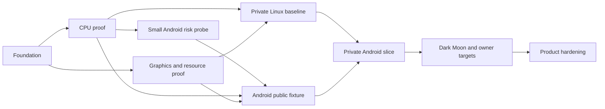

# DroidDS delivery roadmap

<!-- CodexAstraUlt: Replace the research pack's broad serial implementation sequence with evidence-gated work and early Android, memory and correctness risk checks. -->

<!-- CodexAstraUlt: Record the first CPU implementation without promoting full
milestones whose instruction/lifecycle/device gates have not been exercised. -->
Date: 2026-10-17. **The first CPU foundation build 0.0.1 passes locally.**
Exact dependencies, an original test host, strict comparisons and four synthetic
native/fallback cases are implemented. See [build evidence](builds/0.0.1-foundation.md).
M0/M1 are partially demonstrated; full runtime builds, broader CPU/module tests,
graphics and game-performance gates below remain open.
<!-- CodexAstraUlt: The owner continued directly to Android after the automated
Linux gate; cross-compilation does not close A0's execution/graphics criteria. -->
The 0.0.2 [Android CPU probe](ANDROID_PROBE.md) implements the first A0 package and
loader-test slice. Actual Thor execution and the Vulkan draw remain open.

| Milestone | Deliverable | Exit evidence | Dependencies |
| --- | --- | --- | --- |
| M0: reproducible foundation | Exact source/dependency/toolchain pins, provenance inventory, Linux build entry point, public fixture scaffolding | Fresh checkout builds required tools with locked dependencies; tests really execute; mismatched pins fail clearly; distribution notice gaps recorded | Current source audit |
| M1: CPU proof | Synthetic ARM/Thumb/VFP fixture through real generated C and recomp ABI; strict oracle and fallback tests | Native execution counted; integer/memory results exact; justified float comparisons; unknown/stale entries, scheduling and CRO lifetime tests pass; no hidden timeout/skip | M0 |
| A0: Android risk probe | Minimal NDK/Bionic fixture, APK library loading and Vulkan smoke draw | AArch64 fixture executes on Thor and matches Linux; Vulkan device plus representative generic pipeline creates and draws; API/ELF/APK alignment audited; host page size recorded | M0 and smallest passing M1 fixture; parallel with remaining M1/M2 |
| M2: graphics and resource foundation | Existing PICA tests made observable, cold fallback coverage, bounded Vulkan/PICA-JIT work, safe cache persistence | Required GPU tests execute; delayed/failed workers preserve draws; missing generic/helper pipelines cannot silently compile during the qualified gameplay path; queue saturation and repeated teardown remain bounded | M0; CPU and GPU work can proceed in parallel |
| M3: private Linux baseline | One supported owned-title scenario; early Dark Moon compatibility reconnaissance | Controlled interpreter/AOT and graphics comparisons; input/audio/save round trip; exact title revision and cold/warm scope; separate documented Dark Moon blockers | M1, M2; private input supplied to local runner |
| M4: Android public fixture | Thin Android host with input, touch, audio, storage, Vulkan and lifecycle integration | Same fixture outputs as Linux; pause/resume, surface replacement, audio changes, save interruption and normal exit tests pass on Thor | A0, M1, M2 |
| M5: private Android slice | Repeatable local per-title builder, stable signing, matching data import and playable scenario | Native execution proved, wrong revision rejected for AOT, audio/input/save work, cold rendering and memory gates pass; no private artifact in public CI/releases | M3, M4 |
| M6: owner-target qualification | Dark Moon correction/performance work, representative library regressions, dual-display Thor behavior | Matched temporal evidence, sustained normal-speed runs, memory plateau/recovery, qualified 1×/2×/4× results by title/device; public claims limited to tested cases | M5; each fix has a reproducer |
| M7: product hardening | Convenient builder, cache controls, broader devices, texture packs and optional prewarm where justified | Repeatable end-user build/install and save-safe upgrades; demonstrated benefit without correctness regression | M6 for claimed supported titles |

The A0 dependency means the smallest verified CPU fixture, not completion of every
CPU edge-case test. Read-only Android dependency analysis can begin immediately.
Static 16 KiB ELF/APK alignment checks are distinct from execution on a host using
16 KiB pages; Thor execution only qualifies its observed page size. Record untested
page-size configurations explicitly rather than claiming universal compatibility.
M3's private baseline and M4's Android host work may proceed independently once
their prerequisites pass. Device measurements always serialize.

## Initial batch and next work

1. **DDS-001/002:** resolve the actual source/ABI/verifier dependency graph and
   build the pinned Linux tools with a recorded exact toolchain.
2. **DDS-003:** run a small original guest fixture through generated native code
   and the interpreter; deliberately inject bad results and timeouts to test the
   comparison machinery itself.
3. Produce a reproducibility report and select the next bounded task. Do not turn
   this batch into a frontend, complete emulator or private APK project.

The CPU subset of this initial batch is now implemented and locally verified.
The owner need not repeat Linux tests manually. Expand DDS-004/005 and execute the
small A0 Android probe where device access is available. DDS-006 source/test
work can proceed separately. Do not treat the first four fixtures as complete M1.

Read-only reviews of Android constraints and existing GPU tests can run alongside
this batch. A failed toolchain, provenance or oracle gate gets a focused diagnosis
and corrective task; it is not concealed by moving on to more features.

## Title and device selection

Use original synthetic fixtures for public CI. Select the first private control
from titles the owner actually has and that the pinned upstream reports supported,
then confirm the exact revision locally. Monster Hunter 4 Ultimate is one candidate
from the known library and upstream list, not a promised easy or fastest control.
No new game purchase or upload is needed for planning.

Dark Moon is absent from the inspected upstream compatibility list; absence means
unverified, not known incompatible. At M3, run its opening privately to inventory
CPU fallback, missing services, graphics and memory behavior. Keep this early
diagnosis even if the control title is different. M6 must explicitly address Dark
Moon; a successful control title cannot substitute for that owner goal.

The historical Uberhar observation is **Native has no moon flashing; Combo flashes
moon segments**. Ghost corruption is a separate symptom. These observations guide
scene selection; they do not establish the same defect or cause in DroidDS.

Primary device: the owner's AYN Thor Max; remeasure OS/GPU/driver capabilities
rather than relying on an old report. Reference host: Nobara/Linux. Retroid Duo is
future coverage pending exact hardware and access. GammaOS is a compatibility goal
requiring real tests; lack of mandatory Google/vendor services is a design rule.
Other GPU families are later test coverage, not a requirement to buy devices now.

## Success and stopping rules

First establish correct normal-speed 1× output, then 2× and 4×. The owner's desired
endpoint is cold, fully playable 4× where feasible and strong 2× headroom for
texture packs. Do not equate high native instruction coverage, uncapped turbo
speed or a mean near 100% with this result. Use the [test protocol](TEST_STRATEGY.md).

Stop promotion when visual parity, save safety, fallback correctness, memory bounds
or required test execution fails. For a missed performance target, report which
stage dominates and optimize that stage. Do not hide draw omissions, lower accuracy
or change settings mid-comparison to obtain a passing number.

No fixed completion date is defensible before M0/A0 expose build and platform
costs. Re-estimate after each milestone using actual implementation effort and
test results. Review architecture after M2, M5 and any persistent correctness or
memory regression. Universal compatibility and perfect emulation are not release
claims this plan can guarantee.
